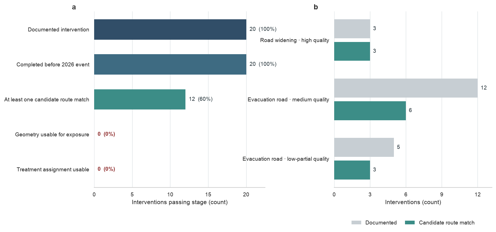

# Intervention Linkage and Eligibility

## Record status

Process record — not a Results figure.

## Purpose

This record documents whether the 20 official intervention entries can be
translated into spatially explicit treatment assignments for the 2026 road
analysis. It preserves the analytical stopping decision before any intervention
effect is estimated.

## Gate summary

| Evidence stage | Records passing | Share |
|---|---:|---:|
| Documented intervention | 20 | 100% |
| Completed before the 2026 event | 20 | 100% |
| At least one candidate route match | 12 | 60% |
| Geometry usable for exposure assignment | 0 | 0% |
| Treatment assignment usable | 0 | 0% |

## Interpretation boundary

Candidate route-name matching identifies possible official road features but
does not recover the completed construction subsegment. No intervention record
currently supplies geometry that can support exposure assignment, so none can
be used as a treatment indicator. The audit therefore records a blocked
evidence chain; it does not estimate or visualize an intervention effect.

## Reproducibility

The record is generated from the processed intervention ledger using the
stage-count definitions \(F_s\) and \(r_s\) in AnaSOP Section 6.3. The source
script validates the expected 20, 20, 12, 0, and 0 stage counts before saving
the accompanying image.
